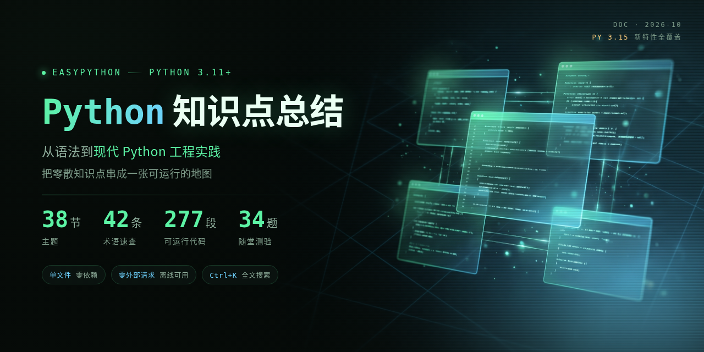

<p align="center">
  
</p>

<h1 align="center">EasyPython</h1>

<p align="center">
  面向<strong>零基础和在校学生</strong>的 Python 实战课件<br>
  从语法到现代 Python 工程实践，把零散知识点串成一张可运行的地图
</p>

<p align="center">
  <a href="https://img.shields.io/badge/Python-3.11%2B-4479A1?logo=python&logoColor=white"></a>
  <a href="LICENSE"></a>
  
  
</p>

<p align="center">
  <a href="https://iphsiibl.github.io/EasyPython/"><strong>🚀 在线阅读</strong></a> ·
  <a href="#怎么用"><strong>📥 本地使用</strong></a> ·
  <a href="#快捷键"><strong>⌨️ 快捷键</strong></a>
</p>

---

> **📌 项目状态**：**38 节正文 + 34 道随堂测验 + 42 条术语速查 + 277 段可运行代码**，全部完成。
> 每一节都按同一套模板写：**为什么这样设计 → 底层机制 → 陷阱清单 → 边界与版本差异 → 进阶用法 → 一道 quiz**。
> 版本事实全部对齐 [peps.python.org](https://peps.python.org/) / [docs.python.org](https://docs.python.org/)，PEP 编号可查证。

---

## 这个仓库和别的 Python 教程有什么不一样

市面上不缺 Python 教程，缺的是**能一直用下去**的。这个仓库只做三件事：

| | 常见教程 | EasyPython |
|---|---|---|
| 形态 | 一堆 Markdown 文件 / 几十个网页 | **1 个 HTML 文件**，双击就开，拷到哪都能用 |
| 依赖 | 要 pip install、要联网看视频 | **零依赖、零外部请求**，断网照样读 |
| 陷阱 | 只给对的写法 | 每节都有**陷阱清单**，专门演示「为什么错」 |
| 版本 | 写着「Python 3.8+」，版本早已过时 | 覆盖到 **Python 3.15**（PEP 810 惰性导入 / PEP 686 UTF-8 默认 / Tachyon 采样器…）|

一句话：**别人的教程让你「看懂」，这个仓库让你「看穿」**。

## 适合谁

✅ 适合

- 刚接触 Python、想把语法到工程实践串起来的学生
- 学完基础语法、想系统补一遍现代 Python 特性的人
- 需要一份**能离线用**的复习资料的人

❌ 不适合

- 想要 ACM 竞赛算法题解
- 想要 Django / FastAPI 全栈项目实战

## 怎么用

### 在线读（GitHub Pages）

直接打开 👉 **[https://iphsiibl.github.io/EasyPython/](https://iphsiibl.github.io/EasyPython/)**

### 本地读（推荐，完完全全离线）

```bash
git clone https://github.com/Iphsiibl/EasyPython.git
cd EasyPython
```

然后**双击 `index.html`**，浏览器就打开了。不用装任何东西，不用起服务器。

> 也可以在 Releases 里下载单个 `Python知识点总结.html`，发给谁都是一整个课件。

### 打印成讲义

课件右上角有 **🖨 打印** 按钮，点一下就是排好版的讲义（还能切换「✓ 答案」决定要不要带上解析）。
浏览器打印时选「另存为 PDF」即可。

## 快捷键

| 按键 | 作用 |
|---|---|
| `Ctrl / ⌘ + K` | 全文搜索（正文、代码、表格、术语全覆盖） |
| `←` `→` | 上一节 / 下一节 |
| `M` | 切换「阅读模式 / 演示模式」 |
| `O` | 打开本课总览 |
| `F` | 全屏 |
| `?` | 快捷键帮助 |
| `Ctrl / ⌘ + P` | 打印讲义 |

## 内容一览

| 分组 | 节数 | 覆盖内容 |
|---|---:|---|
| 启程 | 2 | 封面 · 学习地图 × 为什么学 Python |
| 基础语法 | 4 | 计算机基础 · 变量命名 · 数据类型转换格式化 · 运算符与表达式 |
| 流程控制 | 3 | if 分支 · while · for 与 range |
| 容器类型 | 4 | 字符串索引切片 · 字符串方法 · 列表增删改查 · 元组集合字典与推导式 |
| 函数与进阶 | 5 | 参数返回值作用域 · 嵌套传递与 lambda · 深浅拷贝 · 文件读写 · 上下文管理器 |
| 模块与面向对象 | 3 | 异常处理与标准库 · 类与对象 · 封装继承多态与魔法方法 |
| 高级特性 | 2 | 闭包装饰器迭代器生成器 · 垃圾回收日志与同步异步 |
| 现代 Python | 6 | 类型注解 · dataclass/Enum/描述符 · 结构化模式匹配 · 迭代器协议 · collections 家族 · **Python 3.15 全景** |
| 工程实践 | 7 | 路径与数据格式 · 正则与日期 · **argparse** · **pytest** · 环境与依赖 · 调试与性能 · 并发模型 |
| 收尾 | 2 | 综合实战与课堂小结 · 课后作业 |

## 仓库结构

```
EasyPython/
├── index.html              # 课件本体（GitHub Pages 首页 = 直接进课件）
├── Python知识点总结.html    # 同一份文件的命名副本，方便下载分发
├── banner.png              # 1280×640 README / 社交预览
├── banner@2x.png           # 2560×1280 高清版
├── build/smoke.py          # 49 项端到端回归（playwright）
├── .nojekyll               # 让 Pages 跳过 Jekyll，原样发布静态文件
├── LICENSE                 # MIT
└── README.md
```

## 几处细节

- **零外部请求**：整份课件没有任何 `<link>` / `<script src>` / `` 外链，字体走系统栈，图片全部内联。
- **首屏 1.8s**：原版因为拉 Google Fonts 的 CJK 分片，首屏要 4.3s 且发 54 次网络请求。
- **目录分组可折叠**：点分组标题收起来，状态记在本地。
- **打印前自动补全语法高亮**，导出的 PDF 也是彩色的。

## 贡献

欢迎提 Issue 和 PR。改课件请直接编辑 `index.html`（单文件，所有内容都在里面），改完跑一遍自检：

```bash
python3 build/smoke.py    # 49 项端到端回归
```

## License

[MIT](LICENSE) © 2026 yuguo (Iphsiibl)

课件内容中的示例代码均为教学用途，可自由引用。
